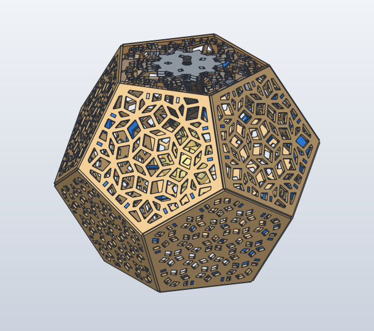

# platonic_lampshades

Lamp shades shaped as Platonic solids. Laser-cut plywood panels joined by laser-cut plywood keys.

| Path | Contents |
|---|---|
| [`docs/overview.md`](docs/overview.md) | Concept, construction, parameters, status. Start here. |
| [`docs/joinery.md`](docs/joinery.md) | Wooden joint concept (cross-section keys) |
| [`docs/light_patterns.md`](docs/light_patterns.md) | Requirements for the light cutout patterns, room sight lines |
| [`cad/`](cad/) | SolidCraft designs, one folder per shade |
| [`tools/`](tools/) | Python scripts: sight-line plots, panel pattern generator |
| [`prototypes/`](prototypes/README.md) | Pattern studies: all patterns tried, with previews |
