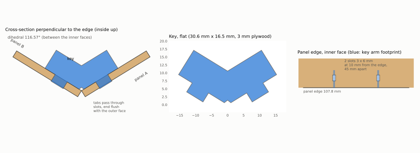

# Wooden Joinery

Joints of the panels with laser-cut plywood parts only. Status: integrated in `cad/dodecahedron/dodecahedron_kit.sc` (50 keys, 10 lug keys). The 3D-printed brackets are removed.

## Constraint
- The laser cuts square to the sheet. It cannot bevel an edge.
- Adjacent panels meet at the dihedral angle δ = 116.57°. Joints that depend on bevelled edges or on fingers meeting at that angle leave gaps or play.
- A plane perpendicular to an edge contains both panel normals. A flat part in that plane passes through both panels square to the sheet, and its 2D outline can carry the angle δ exactly.

## Options
| Option | Principle | Assessment |
|---|---|---|
| Finger joints | Fingers on both panel edges interlock | Needs 90° or bevelled fingers. At 116.57° the fingers overlap or leave gaps. Rejected. |
| Tab and slot in the panels | Tabs on panel A's edge pass through slots in panel B | The tab crosses panel B at 63.4°. A square slot then needs 4.9 mm instead of 3 mm: 1.9 mm play, the angle is not set. Rejected. |
| Glued edge strips | Wooden strip glued into the inner corner | Needs a bevelled or bent strip. Not laser-cuttable. Rejected. |
| **Cross-section keys** | Flat V-shaped key in the plane perpendicular to the edge. Each arm has a tab through a slot in its panel | Square to both panels. The key outline sets δ. Self-jigging. **Chosen.** |

## Cross-section key

Parameters (names as in the SolidCraft design; values in [overview.md](overview.md#dodecahedron-prototype)):

| Parameter | Value | Meaning |
|---|---|---|
| `Larm` | 18 mm | Arm length on the inner face, from the inner corner |
| `Dkey` | 9 mm | Key depth, normal to the inner face |
| `htab` | 10 mm | Tab centre from the inner corner = slot centre from the panel edge |
| `wtab` | 6 mm | Tab width = slot length across the edge |
| `tabout` | 0.3 mm | Tab length beyond the outer face, sanded flush after gluing |
| `rrel` | 1.2 mm | Relief at the inner corner: the key does not touch the panel corners |
| `ek` | 36 mm | Distance between the 2 keys of an edge. Set by the panel pattern: each key arm lies on a tile edge (see [light_patterns.md](light_patterns.md#key-alignment)). Was 45 mm for the Marrakech pattern. |
| `fitt`, `fitw` | 0 mm | Slot size minus key thickness / tab width. Tune with the test coupon. |

- Key: 30.6 mm × 16.5 mm, 3 mm plywood (same sheet as the panels).
- Slot: 3 mm (along the edge) × 6 mm (across the edge), centred 10 mm from the panel edge.
- Each panel edge gets 2 slots. A panel gets 10 slots.
- The tab ends show on the outer face as 3 mm × 6 mm end-grain rectangles, 2 per edge side.
- Keys stay 27.6 mm from the edge ends, so keys of adjacent edges do not meet at the vertices.

Model: sketch `KeySection` (cross-section, 3D keys) and `KeyLaser` (flat, kerf-compensated by `sketch.offset`, export `key_x50.dxf`). `tools/joint_keys.py` draws the figure above and the test coupon; it checks the minimum webs (≥ 3 mm), the clearance between a tab and the other panel and the distance to the edge ends.

## Stability
- **Angle:** the key outline sets δ. A panel on its keys needs no jig. The key arms lie on both inner faces; the tabs fix the key in the slots.
- **Play:** the slot fit sets the play. A tab that is 0.1 mm loose across the 3 mm panel tilts by about 2°. Press fit (tuned `FIT_T`, `FIT_W`) removes it; glue fixes it.
- **Insertion direction:** each tab points along the normal of its panel. A new panel moves along its own normal onto all its keys at once. This also holds for the last panel of each ring.
- **During assembly:** a lower ring panel leans 26.6° outwards and hangs on the 2 keys of its bottom edge until its neighbours brace it. An upper ring panel rests on the 4 keys of its 2 lower edges.

## Assembly
1. Lay the bottom panel flat, inner face up. Press 2 keys into each edge: 10 keys.
2. Lower ring, panel 1: press it along its normal onto the 2 keys of its bottom edge. Press 2 keys into one free side edge.
3. Lower ring, panels 2 to 5: same. Each panel also lands on the keys of its placed neighbour. Panel 5 closes the ring and lands on keys on both sides.
4. Upper ring, panels 1 to 5: same, onto the keys in the lower ring and in the placed neighbour.
5. Glue: apply wood glue to each slot before a tab enters it, and along the key arms. Sand the tab ends flush.

Count: 25 inner edges × 2 = 50 keys.

In the model, 2 keys on the bottom edge are copied by the symmetries of the solid: 3 rotations about the axis of a lower ring panel (its other edges), a half turn to the upper ring side edges, and 5 turns about the vertical axis.

## Top edges (bayonet)
The 5 top edges have no panel on the other side. Each carries 2 lug keys: 10 lug keys.
- Lug key: the key outline without the tab on the top side. Its lower edge, at depth `Dkey` below the inner face of the top plane, rests on the top plate.
- Lock tab: `wlock` × `Lpl` (4 mm × 2.5 mm) on that edge, `hlock` (14 mm) from the inner corner. It sits in a lock slot of the top plate with `clock` (0.5 mm) clearance on each side.
- Top plate: core disc of radius `Rnk` and 10 lobes (`wlb` = 14 mm wide, out to `Rpl`), one under each lug key, with the lock slots. The bayonet turn is `turn` = 15°: the lobes then sit in the gaps between the lug keys, free from about 9° to 22.5° (`ek` = 36 mm).
- Why lobes: the lug keys sit at ±16.7° around each top edge normal (`ek` = 36 mm; ±20.5° with 45 mm). The former narrow notches (5 mm, turned 36°) came within 5° of the next lock slot and needed an exact turn.
- The top plate sits `Dkey` below the inner top plane. Edge length formula: `ri = t + Dkey + tp + Hs + Lc`.
- Plate radius `Rpl` = √((rp − Dkey·cot(δ/2) − cb)² + (ek/2)²): in the plane of each lug key, the plate rim stays `cb` short of the lug key body below the bearing edge. Bearing length on the plate: about 11 mm per lug key.
- Model: sketches `LugKeySection`, `LugKeyLaser` (export `lug_key_x10.dxf`), `PlateCutSketch` (10 gaps between the lobes, 10 lock slots), `TopPlateLaser` (kerf-compensated outline).

## Claims
Claims are statements about the design that a check confirms. Definitions and check commands: [../claims.toml](../claims.toml). Run `just lamp-claims` before an order and after a change to the joints, the bayonet or the parameters. Record each result here.

| Id | Claim | Check | Last result | Date |
|---|---|---|---|---|
| J1 | Joint test coupon: plates and keys do not interfere | headless, `just lamp-claims` (0.2 s) | OK: 0 interferences, 5 pairs | 2026-11-22 |
| K1 | Kit assembled: no interference between panels, keys, lug keys and top plate | app, `inspect.interference` (> 10 min with the pattern panels) | Not run with the Penrose patterns. Partial check with `ek` = 36 mm (bottom panel, top plate, 50 keys, 10 lug keys; pattern panels left out): 0 interferences, 20 pairs. Earlier, Marrakech patterns: 240 s budget ran out, 122 of 165 pairs unchecked, 0 interferences in the 43 checked. | 2026-11-22 |
| K2 | Kit rebuilds with changed `t`, `tk`, `Dkey`, `ek`, `Hs`; bulb centre stays at `ri` | app, `check_parameters` | rebuilds without errors | before 2026-11-22 |
| K3 | Key cross-section rules: tab to arm end, tab to relief, slot web, key to edge end | `just lamp-joint-coupon` (`joint_keys.py check()`, runs with the generator) | OK; key to edge end 34.38 mm (`ek` = 36 mm) | 2026-11-22 |
| K4 | Bayonet: plate 3 mm below its seat turns 0° to 15° without contact; turned 15°, lifts from 3 mm below its seat to 15 mm above it without contact | manual: move and turn `TopPlate`, `inspect.interference` against the lug keys. `turn` drives no geometry, so no script. | no contact (turned +15° and −15°, lift −3 mm to +15 mm in 2 mm steps). Play at 6 mm lift: free from 9° to 22.5°; 7.5° and 24° hit the lug keys. Negative check (not turned, 5 mm up): hits all 10 lug keys. Method: `solid.move` copy of `TopPlate`, `inspect.interference` against the 10 lug keys, undo. | 2026-11-22 (`ek` = 36 mm) |

Earlier result, removed check: keys of different edges at a vertex are 19.5 mm apart with `ek` = 50 mm (vertex test); farther apart with 45 mm and 36 mm.

## Test coupon
Design: `cad/dodecahedron/joint_test.sc`. Two test plates at the dihedral angle and 2 keys, driven by parameters (`t`, `tk`, `Larm`, `Dkey`, `htab`, `wtab`, `tabout`, `rrel`, `ek`). Interference check: no overlap; the tabs fill the slots, the key arms touch the inner faces. For a cross-section, use a section through a key (plane XZ at Y = 15 mm).

`cad/dodecahedron/joint_test_x1.dxf`: 2 plates (60 mm × 40 mm, 2 slots each, 30 mm apart) and 2 keys, kerf-compensated. Sheet: 123 mm × 59 mm.
1. Measure the plywood thickness. Enter it as `measured_thickness` in `../fabrication.toml`. If it differs from 3.0 mm, set `t` and `tk` in both designs (`dodecahedron_kit.sc`, `joint_test.sc`) and save them. `tools/joint_keys.py` reads the values from the designs.
2. Cut the coupon. Press the keys into one plate, then press the second plate onto the keys.
3. Check: the inner corners of the plates touch, the angle is 116.6° (outer angle 63.4°), the joint holds without glue.
4. Adjust `fitt` and `fitw` in `dodecahedron_kit.sc`, save, run `just lamp-joint-coupon` and repeat. Then re-export the DXFs.

## Effect on the other parts
- No 3D-printed parts in the shade.
- Pattern keep-outs: per key, a 3 mm × 18 mm arm footprint and a 3 mm × 6 mm slot with a web, at `ek/2` = 18 mm from the edge centre. `tools/panel_pattern.py` uses these keep-outs.

## Open points
- Test cut: coupon for `fitt`, `fitw` and the angle, together with the pattern test pieces.
- Bayonet test: top plate and lug keys, 15° turn, seat of the lock tabs.
