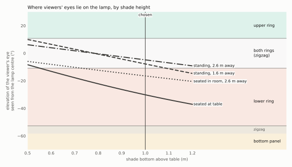
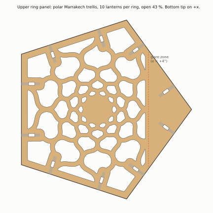

# Light Patterns

Requirements and design zones for the cutout patterns in the panels. Applies to the dodecahedron prototype (see [overview](overview.md)). Status: zones final. Pattern style chosen; upper and lower ring patterns in design (2D); bottom panel and top plate plain.

## Terms
| Term | Definition |
|---|---|
| Elevation angle `e` | Angle of a direction seen from the lamp centre, measured from the horizontal. Positive upward. |
| Face zone | Range of `e` covered by one group of faces. Fixed by the geometry. |
| Design zone | Range of `e` with one pattern purpose: table, glare or projection. Fixed by the room and the lamp height. |
| Bottom panel | The panel on the bottom face. |
| Lower ring | The 5 panels next to the bottom panel. Face normals at `e = −26.6°`. |
| Upper ring | The 5 panels next to the top face. Face normals at `e = +26.6°`. |
| Top plate | The bayonet plate in the top face (see [overview](overview.md#bulb-change-bayonet)). |
| Viewer envelope | Range of eye positions (distance from the lamp axis, eye height) for one kind of viewer. |
| Web | Material left between two cutouts, or between a cutout and the panel edge. |

## Requirements
1. **Top plate clearance.** Cutouts in the top plate must not change the bayonet. Keep:
   - the outline: core disc `Rnk`, 10 lobes `wlb` wide out to `Rpl`;
   - the 10 seats under the lug keys: from radius `Rnk` to the rim along each lug key, plus the lock slots with a web around them;
   - a solid centre for the socket face and the washer: Ø 40 mm or more;
   - enough material to carry the shade (about 0.5 kg) from the 10 seats to the centre.
2. **Panel designs.** Each panel can have its own pattern. Identical patterns are allowed.
3. **Design zones.** Each part of a panel follows the purpose of its design zone (see [Design zones](#design-zones)).
4. **Structure.** The keys hold the shade together (see [joinery.md](joinery.md)). Keep:
   - per key: the key slot (3 mm × 6 mm, centred 10 mm from the edge) with a web around it, and the arm footprint on the inner face (3 mm wide, 18 mm from the edge), at ±22.5 mm from each edge centre;
   - a solid border along the panel edges;
   - a frame on the bottom panel, even when the panel is "almost absent": its 10 keys close the lower ring;
   - webs of at least 3 mm in 3 mm plywood (to be confirmed by a test cut).
5. **Glare alternative.** Glare can also be controlled with a diffuser: matte paper, tracing paper or vellum glued to the inside of a panel. This scatters the light and hides the bulb. The cutouts then show as lit areas, not as sharp beams.
6. **Bulb.** The design must work with a frosted and with a clear bulb (E27, A60).

## Room and lamp height
| Item | Value |
|---|---|
| Room height | 2.5 m |
| Table | 0.75 m high, 1.6 m × 0.9 m |
| Shade bottom above table | **1.00 m** (chosen) |
| Lamp centre | 1.868 m above floor, 0.632 m below ceiling |
| Head clearance | Shade bottom at 1.75 m above floor. Hang the lamp over the table only. |

Viewer envelopes (the figures use a room 6 m wide):

| Viewer | Distance from lamp axis | Eye height | Elevation `e` |
|---|---|---|---|
| Seated at table | 0.9 m to 1.4 m | 1.10 m to 1.30 m | −40.5° to −22.1° |
| Seated in room | 1.5 m to 3.0 m | 1.00 m to 1.20 m | −30.1° to −12.6° |
| Standing | 1.0 m to 3.0 m | 1.45 m to 1.80 m | −22.7° to −1.3° |
| All | | | **−40.5° to −1.3°** |

- All eyes lie below the lamp centre (eye height ≤ 1.80 m < 1.868 m). The upper limit stays below 0° in any room size.
- A margin of 5° on both sides covers the size of the shade (the cutouts sit up to 0.15 m off the lamp centre) and taller viewers.

## Design zones
| Zone | Elevation | Purpose | Pattern goal |
|---|---|---|---|
| Table | `e` < −46° | Light the table | Maximum open area. |
| Glare | −46° ≤ `e` ≤ +4° | Seen by people in the room | No direct view of the bulb: closed, diffuser, or cutouts that block the line of sight. |
| Projection | `e` > +4° | Light the ceiling and upper walls | Interesting projected patterns. |

The table zone covers the whole table: its ends lie at −54.4°, its corners at −50.6°. The table zone lights a disc of 2.2 m diameter at table height.

Mapping onto the panels:

| Panel | Table zone | Glare zone | Projection zone |
|---|---|---|---|
| Bottom panel | all | — | — |
| Lower ring | bottom band: up to 29 mm above the bottom edge (centre line) | middle | top tip: 18 mm below the top vertex (centre line) |
| Upper ring | — | bottom tip: up to 39 mm above the bottom vertex (centre line) | rest |
| Top plate | — | — | all |

Panel height (edge to opposite vertex): 158.9 mm. The zone boundaries are curved on the panels; see the figure below.

Regenerate the figures with `just lamp-figures` (inside the Nix shell). The script prints all values in this section. Change `SHADE_BOTTOM`, `ENVELOPES` or `MARGIN` in the script to move the zones.

## Face zones
| Face zone | Elevation (vertex / edge boundary) |
|---|---|
| Bottom panel | −90° to −52.6° / −58.3° |
| Lower ring | −52.6° to +10.8° |
| Upper ring | −10.8° to +52.6° |
| Top plate | +52.6° / +58.3° to +90° |

The rings overlap between −10.8° and +10.8°: the face edges zigzag around the equator.

## Projection sharpness
The bulb is not a point source. A cutout at distance `d` from the source casts a pattern at distance `L`:

| Quantity | Formula | Top plate (`d` = 0.111 m, `L` = 0.632 m) |
|---|---|---|
| Magnification | `L / d` | 5.7× |
| Blur width | source size × (`L` − `d`) / `d` | 4.7 × source size |

- Frosted A60 bulb (60 mm source): about 280 mm blur. The ceiling shows soft light spots.
- Clear LED filament bulb (about 25 mm filament): about 120 mm blur. The ceiling shows recognisable shapes.
- Make projection features large (projected size ≫ blur), so the pattern reads with either bulb.
- The upper ring is closer to the ceiling in some directions and farther in others, so its projections change in size and blur across the ceiling.

## Pattern
Style: **Marrakech trellis in log-polar coordinates** (5-fold). Status: in design. The studies that led here are in [../prototypes/](../prototypes/README.md).

Alternative under study: Penrose tiling (P3 rhombs, P2 kites and darts), 5-fold. See [Penrose (5-fold)](../prototypes/README.md#penrose-5-fold).

The SolidCraft design carries both patterns: sketches `UpperPattern1Sketch` to `UpperPattern5Sketch` and `LowerPattern1Sketch` to `LowerPattern5Sketch` (one per panel, in the panel plane, pattern +x towards the tip vertex), cut by `UpperPattern<k>Cut` and `LowerPattern<k>Cut` into one panel each. The bottom panel stays plain.

After a pattern change: run `just lamp-patterns`. In each of the 10 pattern sketches, delete the curves and insert the new `<panel>_pattern.dxf` (`sketch.insert_dxf`, `fixed: true`). Export `PanelLaser` as `panel_x1.dxf` first: the generator merges it with the kerf cutouts into `<panel>_panel_x5.dxf`.

Generator: `tools/panel_pattern.py [upper|lower]` (`just lamp-patterns`; `just lamp-inputs` before importing the DXFs into SolidCraft). Per panel type it writes `cad/dodecahedron/<panel>_pattern.dxf`, `<panel>_pattern_kerf.dxf` (shrunk by `kerf/2`) and the preview `docs/img/<panel>_panel_pattern.svg`. It writes no DXF if a check fails. A second argument overrides the lanterns per ring for studies.

| Panel | Lanterns per ring | Zones cut | Holes | Open area | Worst bridge margin |
|---|---|---|---|---|---|
| Upper ring | 10 | projection zone; complete holes reach down to `e` = −1.1° (see below) | 49, 6 mm to 33 mm | 50 % | +0.29 mm |
| Lower ring | 20 | all; glare zone needs a diffuser (requirement 5) | 105, 6 mm to 15 mm | 34 % | +0.29 mm |

- Lower ring: more visible from the room. 20 lanterns per ring give smaller holes and less open area. The lanterns shrink towards the centre; below about 31 mm radius they fall under the minimum hole size and the centre stays solid (Ø 62 mm). The solid centre lies on the face normal (`e` = −26.6°), in the line of sight of seated viewers.
- Lower ring studies (`r0` = 34 mm, before the key alignment): 15 lanterns per ring: 80 holes, 38 % open. 25 lanterns per ring: 105 holes, 24 % open, solid centre about Ø 60 mm.
- Keep-outs: border 6 mm and the keys (`tk` × `Larm` = 3 mm × 18 mm footprint with the slot, at ±`ek/2` from the edge centre, see [joinery.md](joinery.md)).
  - Key nodes (both rings). Upper ring: `ek` = 45 mm puts each key on the trellis bar that meets the edge there; the slot sits next to a bar junction. Lower ring: with `ek` fixed, the radial phase `r0` = 27.4 mm (was 34 mm) moves a bar and a junction onto each key. With `r0` = 34 mm the keys sat in the middle of a lantern (79 % of the arm centreline open); now 24 % of the arm band is open before the keep-out. On both rings the bar widens to a rounded node around the slot: 4.3 mm around the slot (bridge rule maximum + 0.3 mm), 1.5 mm around the arm footprint. The lanterns next to a key stay unclipped. The check measures the bridge from each hole to each slot by the bridge rule (slot size 6 mm) and keeps the arm footprints solid.
- Upper ring, glare zone: the zone does not clip the holes. A hole that reaches below `e` = −1.3° (top of the viewer envelope, no margin) is dropped whole: only the lantern at the bottom tip (lowest point −7.8°). The lanterns next to it stay complete. They reach into the 5° margin of the glare zone: lowest points +1.4° (2 lanterns beside the axis) and −1.1° (2 lanterns at the lower edges). Check: no hole point below −1.3°.
- Panel size: `ri = t + Dkey + tp + Hs + Lc`. Keep the constants at the top of the script in sync with the design.

Bridge rule (checked on the output polylines, between holes, to the panel edge and to the key footprints):

| Larger adjacent hole | Required bridge |
|---|---|
| ≤ 15 mm | 3.0 mm |
| 15 mm to 35 mm | 3.0 mm to 4.0 mm (linear) |
| ≥ 35 mm | 4.0 mm |

## Open points
- Pattern designs for the bottom panel (table zone: frame only) and the top plate (projection zone).
- Lower ring: choose the diffuser, or test the glare without one.
- Test the prototype: cut one upper panel, light it with a clear and a frosted bulb, check the ceiling projection.
- Minimum web width and minimum cutout size: test cut.
- Diffuser material and how to attach it, if the glare zone uses one.
