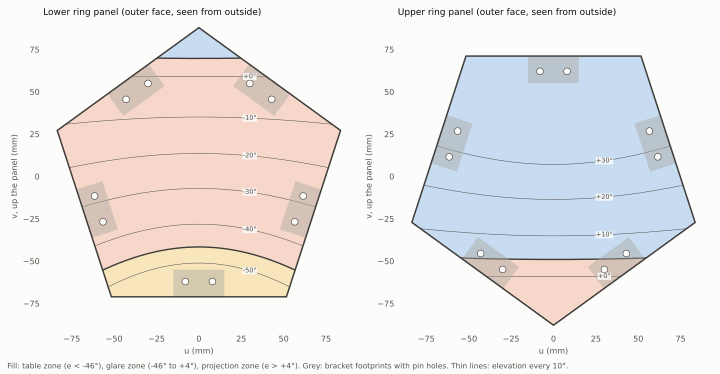
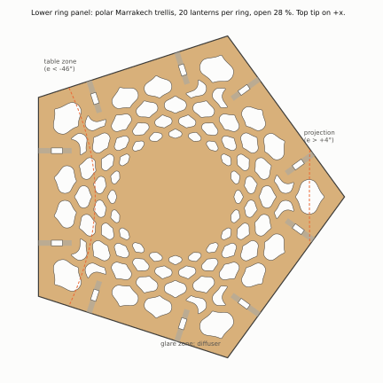
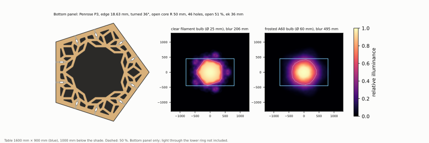
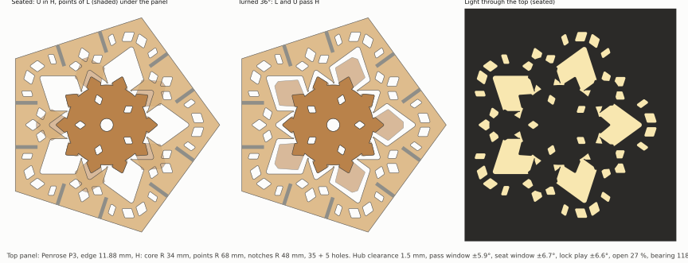

# Light Patterns

Requirements and design zones for the cutout patterns in the panels. Applies to the dodecahedron prototype (see [overview](overview.md)). Status: zones final. Pattern style chosen (Penrose P3); upper and lower ring patterns in design (2D), all holes open; bottom panel: Penrose P3 rim with an open core (2D); top panel: Penrose P3 of the lower ring with the hub hole (2D and in the design).

## Terms
| Term | Definition |
|---|---|
| Elevation angle `e` | Angle of a direction seen from the lamp centre, measured from the horizontal. Positive upward. |
| Face zone | Range of `e` covered by one group of faces. Fixed by the geometry. |
| Design zone | Range of `e` with one pattern purpose: table, glare or projection. Fixed by the room and the lamp height. |
| Bottom panel | The panel on the bottom face. |
| Lower ring | The 5 panels next to the bottom panel. Face normals at `e = −26.6°`. |
| Upper ring | The 5 panels next to the top face. Face normals at `e = +26.6°`. |
| Top panel | The panel in the top face, with the hub hole `H` (see [overview](overview.md#bulb-change-bayonet)). |
| Viewer envelope | Range of eye positions (distance from the lamp axis, eye height) for one kind of viewer. |
| Web | Material left between two cutouts, or between a cutout and the panel edge. |

## Requirements
1. **Top panel and hub.** Cutouts must not change the hub bayonet. `tools/top_panel.py` keeps:
   - the hole `H` and the hub outlines (`L`, `U`) with their pass and seat windows;
   - a solid hub centre for the washer and the spacer: Ø `Dsp` (34 mm) or more;
   - bars under the points of `L` that carry the shade (bearing area ≥ 300 mm²).
2. **Panel designs.** Each panel can have its own pattern. Identical patterns are allowed.
3. **Design zones.** Each part of a panel follows the purpose of its design zone (see [Design zones](#design-zones)).
4. **Structure.** The keys hold the shade together (see [joinery.md](joinery.md)). Keep:
   - per key: the key slot (3 mm × 6 mm, centred 10 mm from the edge) with a web around it, and the arm footprint on the inner face (3 mm wide, 18 mm from the edge), at ±`ek/2` = ±18 mm from each edge centre;
   - a solid border along the panel edges;
   - a frame on the bottom panel, even when the panel is "almost absent": its 10 keys close the lower ring;
   - webs of at least 3 mm in 3 mm plywood (to be confirmed by a test cut).
5. **Glare alternative.** Glare can also be controlled with a diffuser: matte paper, tracing paper or vellum glued to the inside of a panel. This scatters the light and hides the bulb. The cutouts then show as lit areas, not as sharp beams.
6. **Bulb.** The design must work with a frosted and with a clear bulb (E27, A60).

## Room and lamp height
| Item | Value |
|---|---|
| Room height | 2.5 m |
| Table | 0.75 m high, 1.6 m × 0.9 m |
| Shade bottom above table | **1.00 m** (chosen) |
| Lamp centre | 1.868 m above floor, 0.632 m below ceiling |
| Head clearance | Shade bottom at 1.75 m above floor. Hang the lamp over the table only. |

Viewer envelopes (the figures use a room 6 m wide):

| Viewer | Distance from lamp axis | Eye height | Elevation `e` |
|---|---|---|---|
| Seated at table | 0.9 m to 1.4 m | 1.10 m to 1.30 m | −40.5° to −22.1° |
| Seated in room | 1.5 m to 3.0 m | 1.00 m to 1.20 m | −30.1° to −12.6° |
| Standing | 1.0 m to 3.0 m | 1.45 m to 1.80 m | −22.7° to −1.3° |
| All | | | **−40.5° to −1.3°** |

- All eyes lie below the lamp centre (eye height ≤ 1.80 m < 1.868 m). The upper limit stays below 0° in any room size.
- A margin of 5° on both sides covers the size of the shade (the cutouts sit up to 0.15 m off the lamp centre) and taller viewers.

## Design zones
| Zone | Elevation | Purpose | Pattern goal |
|---|---|---|---|
| Table | `e` < −46° | Light the table | Maximum open area. |
| Glare | −46° ≤ `e` ≤ +4° | Seen by people in the room | No direct view of the bulb: closed, diffuser, or cutouts that block the line of sight. |
| Projection | `e` > +4° | Light the ceiling and upper walls | Interesting projected patterns. |

The table zone covers the whole table: its ends lie at −54.4°, its corners at −50.6°. The table zone lights a disc of 2.2 m diameter at table height.

Mapping onto the panels:

| Panel | Table zone | Glare zone | Projection zone |
|---|---|---|---|
| Bottom panel | all | — | — |
| Lower ring | bottom band: up to 29 mm above the bottom edge (centre line) | middle | top tip: 18 mm below the top vertex (centre line) |
| Upper ring | — | bottom tip: up to 39 mm above the bottom vertex (centre line) | rest |
| Top panel | — | — | all |

Panel height (edge to opposite vertex): 158.9 mm. The zone boundaries are curved on the panels; see the figure below.

Regenerate the figures with `just lamp-figures` (inside the Nix shell). The script prints all values in this section. Change `SHADE_BOTTOM`, `ENVELOPES` or `MARGIN` in the script to move the zones.

## Face zones
| Face zone | Elevation (vertex / edge boundary) |
|---|---|
| Bottom panel | −90° to −52.6° / −58.3° |
| Lower ring | −52.6° to +10.8° |
| Upper ring | −10.8° to +52.6° |
| Top panel | +52.6° / +58.3° to +90° |

The rings overlap between −10.8° and +10.8°: the face edges zigzag around the equator.

## Projection sharpness
The bulb is not a point source. A cutout at distance `d` from the source casts a pattern at distance `L`:

| Quantity | Formula | Top panel (`d` = 0.111 m, `L` = 0.632 m) |
|---|---|---|
| Magnification | `L / d` | 5.7× |
| Blur width | source size × (`L` − `d`) / `d` | 4.7 × source size |

- Frosted A60 bulb (60 mm source): about 280 mm blur. The ceiling shows soft light spots.
- Clear LED filament bulb (about 25 mm filament): about 120 mm blur. The ceiling shows recognisable shapes.
- Make projection features large (projected size ≫ blur), so the pattern reads with either bulb.
- The upper ring is closer to the ceiling in some directions and farther in others, so its projections change in size and blur across the ceiling.

## Pattern
Style: **Penrose tiling, P3 rhombs** (5-fold). Status: in design, all holes open. The studies that led here are in [../prototypes/](../prototypes/README.md); the former pattern (log-polar Marrakech trellis) is in [Marrakech (former target)](../prototypes/README.md#marrakech-former-target).

The SolidCraft design carries the Penrose pattern. The 5 panels of a ring are identical, so each ring pattern is cut once and copied:
- `UpperPattern4Sketch` (in the plane of body `Panel (2) (2)`, pattern +x towards the tip vertex) and `UpperPattern4Cut` cut the upper pattern into `Panel (2) (2)`.
- `LowerPattern3Sketch` and `LowerPattern3Cut` cut the lower pattern into `Panel (2)`.
- Both cuts lie between `PanelFlipHalf` and `PanelRing`. `PanelRing` copies the cut panels to the other 4 positions of each ring.
- The bottom panel carries `bottom_pattern.dxf`: sketch `BottomPatternSketch` on XY (the base panel frame), cut by `BottomPatternCut` into body `Panel`. Keep it after `PanelFlipEdge` and `PanelFlipHalf`: they copy `Panel` to the ring positions.

Do not cut a pattern into each ring panel separately: a cut takes 10 s to 70 s, and 10 cuts made the rebuild take 8 min.

After a pattern change: run `just lamp-patterns`. In each of the 3 pattern sketches, delete the curves and insert the new `<panel>_pattern.dxf` (`sketch.insert_dxf`, `fixed: true`). Export `PanelLaser` as `panel_x1.dxf` first: the generators merge it with the kerf cutouts into `<panel>_panel_x5.dxf` and `bottom_panel_x1.dxf`.

Generator: `tools/panel_pattern.py [upper|lower]` (`just lamp-patterns`; `just lamp-inputs` before importing the DXFs into SolidCraft). Per panel type it writes `cad/dodecahedron/<panel>_pattern.dxf`, `<panel>_pattern_kerf.dxf` (shrunk by `kerf/2`), `<panel>_panel_x5.dxf` and the preview `docs/img/<panel>_panel_pattern.svg`. It writes no DXF if a check fails. Variants for studies: `prototypes/penrose_pattern.py`.

Method:
1. Robinson-triangle deflation from a D5-symmetric start wheel at the panel centre (P3: sun of 10 half-rhombs). One mirror axis lies on +x, as on the panel. "Turned 36°" is the other symmetric phase of the patch.
2. The tile edges are the bar centrelines. Rhomb diagonals are not bars. Bar width: bridge rule for the long rhomb diagonal (1.902 × tile edge `a_t`) + 0.3 mm. The bar width is constant.
3. Border 6 mm. Key nodes: the bar widens to a rounded node around each key slot (slot margin = bar width) and keeps 1.5 mm around the arm footprint.
4. Glare: no hole is dropped (status: all open). The preview marks the zone boundaries (dashed) and colours the holes in the glare zone: light orange ≤ 15 mm, red > 15 mm. Upper ring: holes below `e` = −1.3° (bulb visible to a viewer) are hatched.
5. Checks: bridge rule (below), border, key slots and arm footprints, 5-fold symmetry (hole centroids within 0.2 mm under 72° rotation and mirror).

| Panel | Tiling | `a_t` | Phase | Holes | Size | Open area | Bridge margin | Glare zone holes (> 15 mm) | Below −1.3° |
|---|---|---|---|---|---|---|---|---|---|
| Upper ring | P3 | 18.63 mm | turned 36° | 70 | 10 mm to 22 mm | 40 % | +0.96 mm | 11 (5) | 3 |
| Lower ring | P3 | 11.88 mm | — | 90 | 8 mm to 12 mm | 26 % | +0.68 mm | 81 (0) | — |

- Upper ring: 5 holes > 15 mm reach into the glare zone at the bottom tip; 3 holes (lowest point −6.1°) show the bulb to standing viewers. Symmetry does not allow one hole to be dropped without its whole orbit of 5.
- Lower ring: the thin rhombs fall under the minimum hole width (2.4 mm). Only the thick rhombs are cut. Most holes lie in the glare zone; use a diffuser (requirement 5) or test without one.
- Keys: `ek` = 36 mm and the tile edges 18.63 mm / 11.88 mm put each key arm on a tile edge (offset 0.28 mm). See [Key alignment](#key-alignment). The generator prints the offset.
- Panel size and key positions come from the design (`tools/design.py`).

### Key alignment
Goal: each key arm lies on a tile edge, as on the Marrakech pattern. Chosen (2026-11-22): key spacing, `ek` = 36 mm. The tiling has edges parallel to the key arms (tile edge directions are multiples of 36°). The 10 keys form one symmetry orbit: aligning one key aligns all 10.

| Option | Change | Arm offset from the nearest tile edge (upper / lower) | Result |
|---|---|---|---|
| None | `ek` = 45 mm, `a_t` 18 mm / 12 mm (the study values) | 5.4 mm / 4.0 mm | nodes clip the neighbouring holes |
| Scale only | `a_t` within ±10 % | ≥ 3.7 mm / ≥ 2.7 mm | not aligned |
| Local warp | tile vertices near each key moved by 5.4 mm / 4.0 mm, smooth falloff over 14 mm to 18 mm | 0 mm | aligned; the rhombs next to the keys shear visibly |
| **Key spacing (chosen)** | `ek` = 36 mm, `a_t` = 18.63 mm (+3.5 %) / 11.88 mm (−1.0 %) | 0.3 mm / 0.3 mm | aligned without distortion. Upper: 70 holes, 40 %; lower: 90 holes, 26 %. One hole per key on the upper ring keeps a small notch. |

`ek` = 36 mm moves the keys 4.5 mm towards the edge centre: farther from the vertices (see [joinery.md](joinery.md)).

Bridge rule (checked on the output polylines, between holes, to the panel edge and to the key slots):

| Larger adjacent hole | Required bridge |
|---|---|
| ≤ 15 mm | 3.0 mm |
| 15 mm to 35 mm | 3.0 mm to 4.0 mm (linear) |
| ≥ 35 mm | 4.0 mm |

### Bottom panel
The bottom panel lies in the table zone: no viewer sees the bulb through it. Goal: a mostly open panel with a frame that holds the 10 keys.

| Item | Value |
|---|---|
| Tiling | P3, tile edge and phase of the upper ring (18.63 mm, turned 36°). The keys sit on tile edges as on the upper ring. |
| Open core | The rhombs with the centre within R 50 mm are not cut into bars: one core hole (106.7 mm). |
| Bars | 4.3 mm (bridge rule next to the core + 0.3 mm) |
| Frame | 8 mm, rounded inner corners, key nodes as on the ring panels |
| Result (`ek` = 36 mm) | 46 holes, 9.7 mm to 106.7 mm, 51 % open. Margins: bridge +0.30 mm, edge +4.94 mm, key +0.03 mm. |

Generator: `tools/bottom_pattern.py` (part of `just lamp-patterns`). It writes `cad/dodecahedron/bottom_pattern.dxf`, `bottom_pattern_kerf.dxf`, `bottom_panel_x1.dxf` and the preview `docs/img/bottom_panel_pattern.svg`. `--ek MM` previews another key spacing.

Light on the table: `tools/table_light.py`. It projects the holes onto the table and blurs them by the source size (see [Projection sharpness](#projection-sharpness); blur 206 mm for a clear filament bulb, 495 mm for a frosted bulb). The model includes the bottom panel only.
- Clear bulb: a bright pentagonal pool, about 1 m wide, with a faint halo from the rim rhombs.
- Frosted bulb: a soft round pool.
- The frame shadow falls at about 450 mm to 550 mm from the axis, at the long edges of the table.

Variants (window, Marrakech, medallion, Penrose): [Bottom panel study](../prototypes/README.md#bottom-panel).

### Top panel
The top panel lies in the projection zone. Its pattern and the hub show on the ceiling.

| Item | Value |
|---|---|
| Tiling | P3, tile edge and phase of the lower ring (11.88 mm, bar 3.68 mm). The keys sit on tile edges as on the lower ring. |
| Hole `H` | Round core R 34 mm, 5 rhombus petals to R 68 mm (rhomb edge 30.14 mm = 18.63 mm × φ) towards the vertices, 5 rhombus petals to R 48 mm (rhomb edge 18.63 mm) towards the edges. The petal sides are parallel to the tile edges. |
| Holes | Every tile outside `H` is a hole: shrunk by up to 3 mm beyond the bar to fit, else clipped when ≥ 40 % of it remains. The hub carries the tiles inside it as holes (web 3.4 mm, solid within R 17 mm). |
| Result | 35 panel holes, 5 hub holes, 27 % of the top open seen from the ceiling (holes, the 5 large petals of `H` and the seam around `U`). |
| Bayonet | Pass window ±5.9°, seat window ±6.7°, clearance 1.5 mm, lock play ±6.6°, bearing 1181 mm², bulb passage Ø 68 mm. |

Generator: `tools/top_panel.py` (part of `just lamp-patterns`). It writes `cad/dodecahedron/top_pattern.dxf`, `top_pattern_kerf.dxf`, `top_panel_x1.dxf`, `hub_lower.dxf`, `hub_upper.dxf`, `hub_x1.dxf` and the preview `docs/img/top_panel_pattern.svg`. The design imports `top_pattern.dxf` (sketch `TopPatternSketch`, cut `TopPatternCut` into `Panel (3)`), `hub_lower.dxf` and `hub_upper.dxf` (sketches `HubLowerSketch`, `HubUpperSketch`), each turned by 36° into the kit frame.

Design history: hole `H` from the tiles within R 52 mm (upper ring tiles, then lower ring tiles) gave a pass window of only ±1.1°: the many short tooth edges of `H` limit the turn to clearance ÷ radius. The drawn petals give wide teeth; the hub is cut to fit over the whole window.

## Open points
- Glare: all holes are open. Decide per panel: drop or close the glare zone holes, or use a diffuser.
- Bottom panel: test-cut the 8 mm frame for stiffness. Check whether the bulb can be changed through the open core (106.7 mm) without the bayonet.
- Lower ring: choose the diffuser, or test the glare without one.
- Test the prototype: cut one upper panel, light it with a clear and a frosted bulb, check the ceiling projection.
- Minimum web width and minimum cutout size: test cut.
- Diffuser material and how to attach it, if the glare zone uses one.
