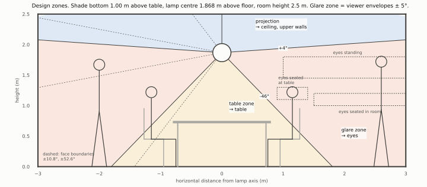
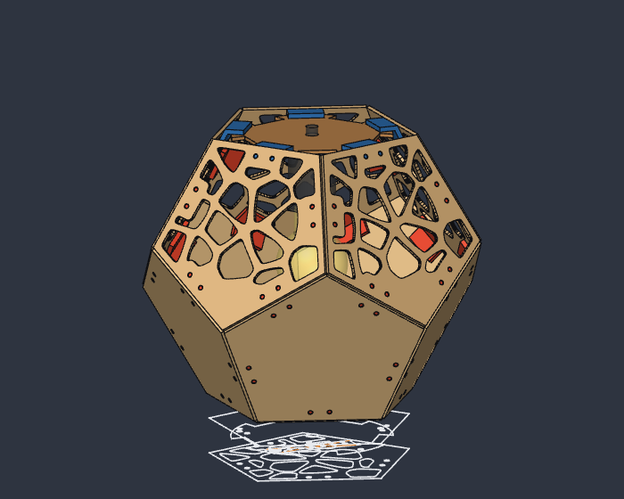
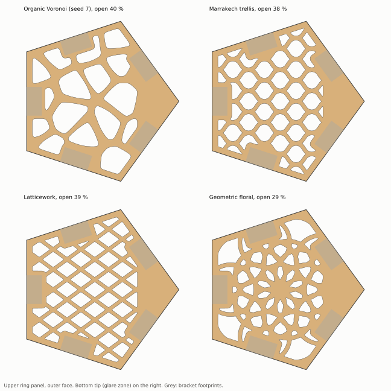

# Light Patterns

Requirements and design zones for the cutout patterns in the panels. Applies to the dodecahedron prototype (see [overview](overview.md)). Status: zones final. Prototype pattern on the upper ring; other panels plain.

## Terms
| Term | Definition |
|---|---|
| Elevation angle `e` | Angle of a direction seen from the lamp centre, measured from the horizontal. Positive upward. |
| Face zone | Range of `e` covered by one group of faces. Fixed by the geometry. |
| Design zone | Range of `e` with one pattern purpose: table, glare or projection. Fixed by the room and the lamp height. |
| Bottom panel | The panel on the bottom face. |
| Lower ring | The 5 panels next to the bottom panel. Face normals at `e = −26.6°`. |
| Upper ring | The 5 panels next to the top face. Face normals at `e = +26.6°`. |
| Top plate | The bayonet plate in the top face (see [overview](overview.md#bulb-change-bayonet)). |
| Viewer envelope | Range of eye positions (distance from the lamp axis, eye height) for one kind of viewer. |
| Web | Material left between two cutouts, or between a cutout and the panel edge. |

## Requirements
1. **Top plate clearance.** Cutouts in the top plate must not change the bayonet. Keep:
   - the outline: radius `Rpl`, the 5 notches (`Rn`, `wn`);
   - the 5 seats under the top brackets: radius `Rn` to `Rpl`, ±`Lb/2` around each lock pin, plus the lock pin holes `dlock` with a web around them;
   - a solid centre for the socket face and the washer: Ø 40 mm or more;
   - enough material to carry the shade (about 0.6 kg) from the 5 seats to the centre.
2. **Panel designs.** Each panel can have its own pattern. Identical patterns are allowed.
3. **Design zones.** Each part of a panel follows the purpose of its design zone (see [Design zones](#design-zones)).
4. **Structure.** The brackets hold the shade together. Keep:
   - a solid border under each bracket: `Lf` (16 mm) plus margin from the edge, over `Lb` (30 mm) plus margin around the edge centre, with the pin holes;
   - a frame on the bottom panel, even when the panel is "almost absent": its 5 brackets close the lower ring;
   - webs of at least 3 mm in 3 mm plywood (to be confirmed by a test cut).
5. **Glare alternative.** Glare can also be controlled with a diffuser: matte paper, tracing paper or vellum glued to the inside of a panel. This scatters the light and hides the bulb. The cutouts then show as lit areas, not as sharp beams.
6. **Bulb.** The design must work with a frosted and with a clear bulb (E27, A60).

## Room and lamp height
| Item | Value |
|---|---|
| Room height | 2.5 m |
| Table | 0.75 m high, 1.6 m × 0.9 m |
| Shade bottom above table | **1.00 m** (chosen) |
| Lamp centre | 1.868 m above floor, 0.632 m below ceiling |
| Head clearance | Shade bottom at 1.75 m above floor. Hang the lamp over the table only. |

Viewer envelopes (the figures use a room 6 m wide):

| Viewer | Distance from lamp axis | Eye height | Elevation `e` |
|---|---|---|---|
| Seated at table | 0.9 m to 1.4 m | 1.10 m to 1.30 m | −40.5° to −22.1° |
| Seated in room | 1.5 m to 3.0 m | 1.00 m to 1.20 m | −30.1° to −12.6° |
| Standing | 1.0 m to 3.0 m | 1.45 m to 1.80 m | −22.7° to −1.3° |
| All | | | **−40.5° to −1.3°** |

- All eyes lie below the lamp centre (eye height ≤ 1.80 m < 1.868 m). The upper limit stays below 0° in any room size.
- A margin of 5° on both sides covers the size of the shade (the cutouts sit up to 0.15 m off the lamp centre) and taller viewers.

## Design zones
| Zone | Elevation | Purpose | Pattern goal |
|---|---|---|---|
| Table | `e` < −46° | Light the table | Maximum open area. |
| Glare | −46° ≤ `e` ≤ +4° | Seen by people in the room | No direct view of the bulb: closed, diffuser, or cutouts that block the line of sight. |
| Projection | `e` > +4° | Light the ceiling and upper walls | Interesting projected patterns. |

The table zone covers the whole table: its ends lie at −54.4°, its corners at −50.6°. The table zone lights a disc of 2.2 m diameter at table height.

Mapping onto the panels:

| Panel | Table zone | Glare zone | Projection zone |
|---|---|---|---|
| Bottom panel | all | — | — |
| Lower ring | bottom band: up to 29 mm above the bottom edge (centre line) | middle | top tip: 18 mm below the top vertex (centre line) |
| Upper ring | — | bottom tip: up to 39 mm above the bottom vertex (centre line) | rest |
| Top plate | — | — | all |

Panel height (edge to opposite vertex): 158.9 mm. The zone boundaries are curved on the panels; see the figure below.

Regenerate the figures with `python3 platonic_lampshades/tools/plot_sight_lines.py` (inside the Nix shell). The script prints all values in this section. Change `SHADE_BOTTOM`, `ENVELOPES` or `MARGIN` in the script to move the zones.

## Face zones
| Face zone | Elevation (vertex / edge boundary) |
|---|---|
| Bottom panel | −90° to −52.6° / −58.3° |
| Lower ring | −52.6° to +10.8° |
| Upper ring | −10.8° to +52.6° |
| Top plate | +52.6° / +58.3° to +90° |

The rings overlap between −10.8° and +10.8°: the face edges zigzag around the equator.

## Projection sharpness
The bulb is not a point source. A cutout at distance `d` from the source casts a pattern at distance `L`:

| Quantity | Formula | Top plate (`d` = 0.111 m, `L` = 0.632 m) |
|---|---|---|
| Magnification | `L / d` | 5.7× |
| Blur width | source size × (`L` − `d`) / `d` | 4.7 × source size |

- Frosted A60 bulb (60 mm source): about 280 mm blur. The ceiling shows soft light spots.
- Clear LED filament bulb (about 25 mm filament): about 120 mm blur. The ceiling shows recognisable shapes.
- Make projection features large (projected size ≫ blur), so the pattern reads with either bulb.
- The upper ring is closer to the ceiling in some directions and farther in others, so its projections change in size and blur across the ceiling.

## Prototype: upper ring
The 5 upper ring panels carry an organic cell pattern for the projection zone: curved webs that thicken at the junctions (inspired by organic Voronoi lamp shades).

Generator: `tools/voronoi_pattern.py` (distance field on a 0.25 mm grid):
1. 19 seed points with a minimum spacing, one Lloyd relaxation step.
2. Web field: half the difference between the distances to the nearest and second-nearest seed, in smoothly warped coordinates (warp up to 5 mm). The webs curve.
3. Web width: smooth random field, 4 mm to 8 mm.
4. Keep-outs: border 6 mm at the panel edge, 3 mm around the bracket footprints, 3 mm to the glare zone line.
5. Gaussian blur (σ = 1.6 mm): rounds all corners, thickens the junctions.
6. Cutouts: closed contours of the field, simplified to 0.03 mm, written as line segments.
7. Check on the output polylines; the script writes no DXF if a check fails.

| Result (seed 7) | Value | Requirement |
|---|---|---|
| Cutouts | 16 | — |
| Open area | 7408 mm² (40 % of the panel) | — |
| Minimum web | 3.42 mm | ≥ 3.0 mm |
| Distance to panel edge | 6.0 mm | — |
| Distance to bracket footprints | 2.53 mm | ≥ 2.0 mm |
| Lowest cutout point | `e` = +5.75° | > +4° (projection zone) |

- Cells are 15 mm to 35 mm across, webs 3.4 mm to 8 mm.
- Projection: cells project to about 85 mm to 200 mm on the ceiling. Web shadows (20 mm to 45 mm) are smaller than the blur of an A60 bulb, clear (120 mm) or frosted (280 mm). Expect soft light cells, not sharp lines. Sharp shadow lines as in the inspiration photos need a small source (a few mm), for example a single-chip LED.
- Other seeds give other patterns with the same rules. Each of the 5 panels can get its own seed.

Model: body `UpperPanel` (built flat from `Panel`, cut by sketch `UpperPatternSketch`, then turned into the upper ring position, patterned 5×). Laser: sketch `UpperPanelLaser`, export `upper_panel_x5.dxf`.

Update after a parameter change:
1. Run `python3 platonic_lampshades/tools/voronoi_pattern.py <seed>`. It writes `cad/dodecahedron/upper_pattern.dxf` (nominal) and `upper_pattern_kerf.dxf` (shrunk by `kerf/2`).
2. In `UpperPatternSketch`, delete the pattern curves and insert `upper_pattern.dxf` (`sketch.insert_dxf`, `fixed: true`).
3. In `UpperPanelLaser`, delete the pattern curves and insert `upper_pattern_kerf.dxf`. Keep the outline and the pin holes.
4. Export `upper_panel_x5.dxf`.

The script takes the design values (`t`, `tb`, `tp`, `Hs`, `Lc`, `Lf`, `Lb`, `kerf`) from constants at its top. Keep them in sync with the design.

## Style alternatives
Three alternatives to the organic Voronoi prototype, for the style decision. Generator: `tools/pattern_styles.py`. The model still carries the Voronoi pattern.

Shared pipeline: cutouts are the points farther than half the bar width from the style's line network (skeleton). Keep-outs: border 6 mm, 4.5 mm around the bracket footprints, 3 mm to the glare zone. A light blur (σ = 0.5 mm) gives inner corners a radius of about 1 mm. Holes narrower than 2.4 mm or smaller than 15 mm² are dropped.

Bridge rule (checked on the output polylines, between holes and to the border and the bracket footprints):

| Larger adjacent hole | Required bridge |
|---|---|
| ≤ 15 mm | 3.0 mm |
| 15 mm to 35 mm | 3.0 mm to 4.0 mm (linear) |
| ≥ 35 mm | 4.0 mm |

| Style | Skeleton | Bars | Holes | Open area | Worst bridge margin |
|---|---|---|---|---|---|
| Organic Voronoi | warped Voronoi edges, seed 7 | 3.4 mm to 8 mm | 16, up to 35 mm | 40 % | **−0.51 mm: fails** (3.42 mm next to a 34 mm hole) |
| Marrakech trellis | Moroccan lanterns 22 mm × 33 mm: diamond tiling with S-curved edges | 4.0 mm | 43, up to 20 mm | 38 % | +0.74 mm |
| Latticework | rhombic trellis, bar spacing 17 mm, 72° / 108° rhombi (pentagon angles) | 3.6 mm | 49, up to 22 mm | 39 % | +0.27 mm |
| Geometric floral | 10-fold flower of life: 20 circles of radius 26 mm and an inner circle | 3.3 mm (centre) to 4.2 mm (outer) | 51, up to 33 mm | 29 % | +0.27 mm |

- The Voronoi prototype was generated with a flat 3 mm rule. It fails the size-dependent rule between holes and at the bracket footprints (2.5 mm clearance). If Voronoi is chosen: raise `W_MIN` to 5 mm and `KEEP_MARGIN` to 4.5 mm in `voronoi_pattern.py` and regenerate.
- All patterns stay in the projection zone (lowest point `e` ≥ +5.7°).
- Periodic styles (Marrakech, latticework) are centred on the panel axis and cut by the border and the bracket footprints. Partial holes at the edges are part of the look.
- The floral style has 5-fold symmetry about the panel centre; the bracket footprints and the glare zone cut its outer ring.
- Each style writes `cad/dodecahedron/upper_pattern_<style>.dxf` and `..._kerf.dxf` for the import into SolidCraft (see the update steps above).

## Open points
- Style decision: Voronoi, Marrakech, latticework or floral.
- Pattern designs for the bottom panel (table zone: frame only), the lower ring (glare zone) and the top plate (projection zone).
- Test the prototype: cut one upper panel, light it with a clear and a frosted bulb, check the ceiling projection.
- Minimum web width and minimum cutout size: test cut.
- Diffuser material and how to attach it, if the glare zone uses one.
