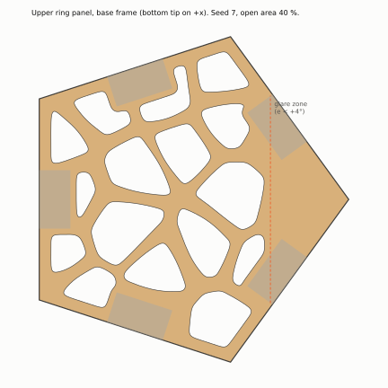
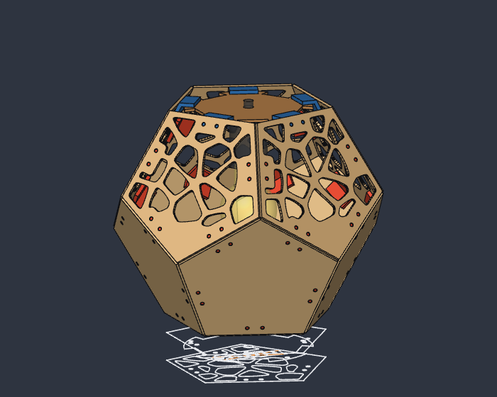

# Pattern Prototypes

Pattern studies that were not chosen. Kept for reference; not maintained.

| File | Contents |
|---|---|
| `voronoi_pattern.py` | Organic Voronoi generator. Also holds helpers that `pattern_styles.py` imports. |
| `pattern_styles.py` | Marrakech (flat, log-polar, lantern rings), latticework, geometric floral |
| `img/` | Previews of all studies, a render of the Voronoi pattern on the shade |
| `dxf/` | Pattern DXFs of the studies (generated, not in git) |

- The scripts write into `../docs/img/` and `../cad/dodecahedron/`. Running them overwrites the current pattern outputs there.
- Requirements, zones and the bridge rule: [../docs/light_patterns.md](../docs/light_patterns.md).
- The chosen style (log-polar Marrakech trellis) continues in `../tools/panel_pattern.py`.
- The SolidCraft design still carries the Voronoi pattern (body `UpperPanel`, sketches `UpperPatternSketch`, `UpperPanelLaser`) until the chosen pattern replaces it.

## Organic Voronoi (first prototype)
The 5 upper ring panels carry an organic cell pattern for the projection zone: curved webs that thicken at the junctions (inspired by organic Voronoi lamp shades).

Generator: `prototypes/voronoi_pattern.py` (distance field on a 0.25 mm grid):
1. 19 seed points with a minimum spacing, one Lloyd relaxation step.
2. Web field: half the difference between the distances to the nearest and second-nearest seed, in smoothly warped coordinates (warp up to 5 mm). The webs curve.
3. Web width: smooth random field, 4 mm to 8 mm.
4. Keep-outs: border 6 mm at the panel edge, 3 mm around the bracket footprints, 3 mm to the glare zone line.
5. Gaussian blur (σ = 1.6 mm): rounds all corners, thickens the junctions.
6. Cutouts: closed contours of the field, simplified to 0.03 mm, written as line segments.
7. Check on the output polylines; the script writes no DXF if a check fails.

| Result (seed 7) | Value | Requirement |
|---|---|---|
| Cutouts | 16 | — |
| Open area | 7408 mm² (40 % of the panel) | — |
| Minimum web | 3.42 mm | ≥ 3.0 mm |
| Distance to panel edge | 6.0 mm | — |
| Distance to bracket footprints | 2.53 mm | ≥ 2.0 mm |
| Lowest cutout point | `e` = +5.75° | > +4° (projection zone) |

- Cells are 15 mm to 35 mm across, webs 3.4 mm to 8 mm.
- Projection: cells project to about 85 mm to 200 mm on the ceiling. Web shadows (20 mm to 45 mm) are smaller than the blur of an A60 bulb, clear (120 mm) or frosted (280 mm). Expect soft light cells, not sharp lines. Sharp shadow lines as in the inspiration photos need a small source (a few mm), for example a single-chip LED.
- Other seeds give other patterns with the same rules. Each of the 5 panels can get its own seed.

Model: body `UpperPanel` (built flat from `Panel`, cut by sketch `UpperPatternSketch`, then turned into the upper ring position, patterned 5×). Laser: sketch `UpperPanelLaser`, export `upper_panel_x5.dxf`.

Update after a parameter change:
1. Run `python3 platonic_lampshades/prototypes/voronoi_pattern.py <seed>`. It writes `cad/dodecahedron/upper_pattern.dxf` (nominal) and `upper_pattern_kerf.dxf` (shrunk by `kerf/2`).
2. In `UpperPatternSketch`, delete the pattern curves and insert `upper_pattern.dxf` (`sketch.insert_dxf`, `fixed: true`).
3. In `UpperPanelLaser`, delete the pattern curves and insert `upper_pattern_kerf.dxf`. Keep the outline and the pin holes.
4. Export `upper_panel_x5.dxf`.

The script takes the design values (`t`, `tb`, `tp`, `Hs`, `Lc`, `Lf`, `Lb`, `kerf`) from constants at its top. Keep them in sync with the design.

## Style alternatives
Three alternatives to the organic Voronoi prototype, for the style decision. Generator: `prototypes/pattern_styles.py`. The model still carries the Voronoi pattern.

Shared pipeline: cutouts are the points farther than half the bar width from the style's line network (skeleton). Keep-outs: border 6 mm, 4.5 mm around the bracket footprints, 3 mm to the glare zone. A light blur (σ = 0.5 mm) gives inner corners a radius of about 1 mm. Holes narrower than 2.4 mm or smaller than 15 mm² are dropped.

Bridge rule (checked on the output polylines, between holes and to the border and the bracket footprints):

| Larger adjacent hole | Required bridge |
|---|---|
| ≤ 15 mm | 3.0 mm |
| 15 mm to 35 mm | 3.0 mm to 4.0 mm (linear) |
| ≥ 35 mm | 4.0 mm |

| Style | Skeleton | Bars | Holes | Open area | Worst bridge margin |
|---|---|---|---|---|---|
| Organic Voronoi | warped Voronoi edges, seed 7 | 3.4 mm to 8 mm | 16, up to 35 mm | 40 % | **−0.51 mm: fails** (3.42 mm next to a 34 mm hole) |
| Marrakech trellis | Moroccan lanterns 22 mm × 33 mm: diamond tiling with S-curved edges | 4.0 mm | 43, up to 20 mm | 38 % | +0.74 mm |
| Latticework | rhombic trellis, bar spacing 17 mm, 72° / 108° rhombi (pentagon angles) | 3.6 mm | 49, up to 22 mm | 39 % | +0.27 mm |
| Geometric floral | 10-fold flower of life: 20 circles of radius 26 mm and an inner circle | 3.3 mm (centre) to 4.2 mm (outer) | 51, up to 33 mm | 29 % | +0.27 mm |

- The Voronoi prototype was generated with a flat 3 mm rule. It fails the size-dependent rule between holes and at the bracket footprints (2.5 mm clearance). If Voronoi is chosen: raise `W_MIN` to 5 mm and `KEEP_MARGIN` to 4.5 mm in `voronoi_pattern.py` and regenerate.
- All patterns stay in the projection zone (lowest point `e` ≥ +5.7°).
- Periodic styles (Marrakech, latticework) are centred on the panel axis and cut by the border and the bracket footprints. Partial holes at the edges are part of the look.
- The floral style has 5-fold symmetry about the panel centre; the bracket footprints and the glare zone cut its outer ring.
- Each style writes `cad/dodecahedron/upper_pattern_<style>.dxf` and `..._kerf.dxf` for the import into SolidCraft (see the update steps above).

## Marrakech with 5-fold symmetry
Quick prototypes: the lantern pattern arranged around the panel centre, with the holes growing outwards. Styles `marrakech_polar10` and `marrakech_rings` in `prototypes/pattern_styles.py`.

| Variant | Method | Holes | Open area | Worst bridge margin |
|---|---|---|---|---|
| Flat trellis | reference, see above | 43, up to 20 mm | 38 % | +0.74 mm |
| Log-polar, 10 per ring | trellis in log-polar coordinates (conformal map). Bar width in mm follows the local hole size (bridge rule + 0.3 mm). Solid hub r = 14 mm | 44, 6 mm to 35 mm | 38 % | +0.28 mm |
| Lantern rings | rings of 10 undistorted lanterns (outline taken from the flat trellis), every second ring turned by 18°. Ring radius × 1.62 per ring (trellis proportions). Width = arc spacing − bridge − 0.4 mm, outline shrunk by 0.7 mm | 42, 5 mm to 31 mm | 36 % | +0.23 mm |

- Both variants have 10-fold rotational symmetry (contains the 5-fold symmetry of the face) and mirror symmetry about the panel axis. The bracket footprints and the glare zone cut the outer ring.
- Log-polar: with 10 lanterns per ring, the scale changes by a factor of 2 from the inner to the outer tip of one lantern. The lanterns turn into curved teardrops; the trellis bars stay continuous.
- Lantern rings: each lantern keeps its shape. The bars are no longer continuous trellis bars; the panel reads as a rosette of lanterns, as on pierced Moroccan brass lanterns. Shrinking and blurring round the lantern tips.
- More lanterns per ring (15, 20) reduce the distortion of the log-polar variant but make the inner holes too small for the bridge rule.

