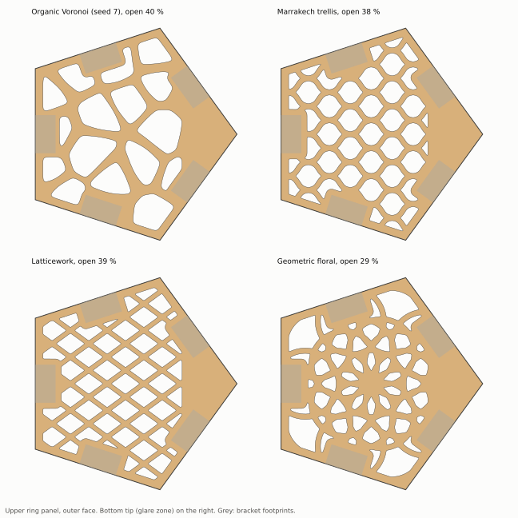
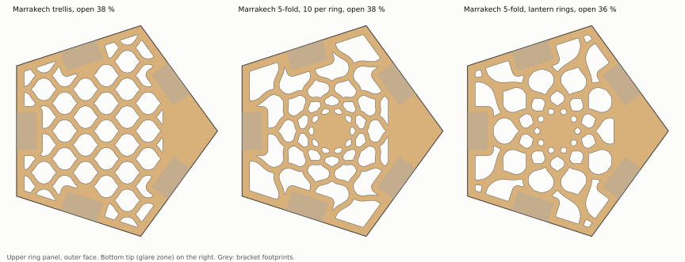
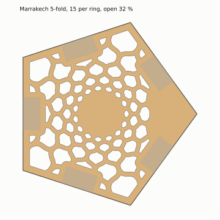
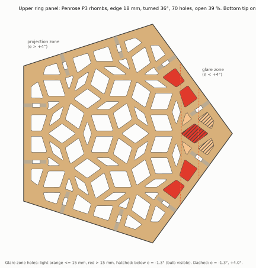
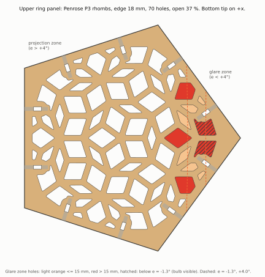
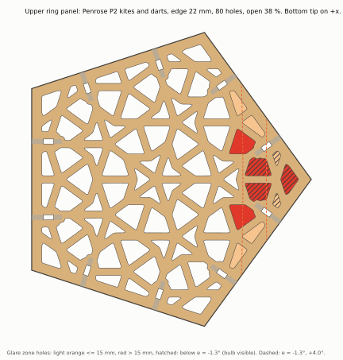
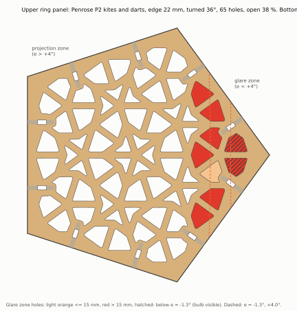
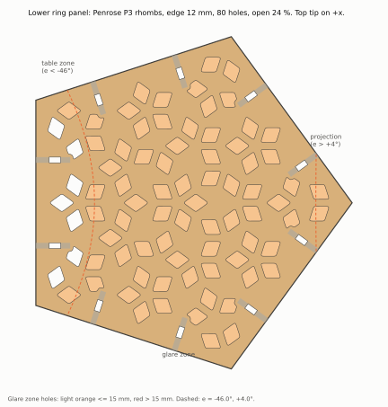
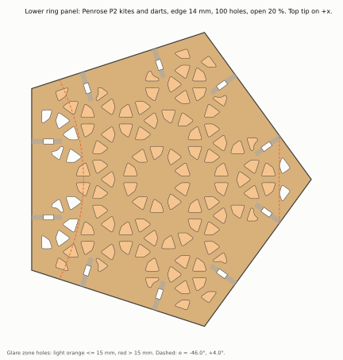

# Pattern Prototypes

Pattern studies for the ring panels. Kept for reference; not maintained. The chosen pattern (log-polar Marrakech trellis) is in [../docs/light_patterns.md](../docs/light_patterns.md#pattern).

## Overview
All patterns tried, in order. Upper ring panel unless noted.

| Pattern | Section | Open area | Status | Preview |
|---|---|---|---|---|
| Organic Voronoi | [Organic Voronoi](#organic-voronoi-first-prototype) | 40 % | rejected; fails the bridge rule | [`voronoi_panel.svg`](img/voronoi_panel.svg) |
| Marrakech trellis, flat | [Style alternatives](#style-alternatives) | 38 % | chosen style; replaced by the log-polar variant | [`pattern_marrakech.svg`](img/pattern_marrakech.svg) |
| Latticework | [Style alternatives](#style-alternatives) | 39 % | rejected | [`pattern_lattice.svg`](img/pattern_lattice.svg) |
| Geometric floral | [Style alternatives](#style-alternatives) | 29 % | rejected | [`pattern_floral.svg`](img/pattern_floral.svg) |
| Marrakech log-polar, 10 per ring | [Marrakech with 5-fold symmetry](#marrakech-with-5-fold-symmetry) | 38 % | chosen; continued in `../tools/panel_pattern.py` | [`pattern_marrakech_polar10.svg`](img/pattern_marrakech_polar10.svg) |
| Marrakech log-polar, 15 per ring | [Marrakech with 5-fold symmetry](#marrakech-with-5-fold-symmetry) | 32 % | rejected | [`pattern_marrakech_polar15.svg`](img/pattern_marrakech_polar15.svg) |
| Marrakech lantern rings | [Marrakech with 5-fold symmetry](#marrakech-with-5-fold-symmetry) | 36 % | rejected | [`pattern_marrakech_rings.svg`](img/pattern_marrakech_rings.svg) |
| Marrakech log-polar, lower ring, 15 / 20 / 25 per ring | [../docs/light_patterns.md](../docs/light_patterns.md#pattern) | 38 % / 34 % / 24 % (15 and 25 at `r0` = 34 mm) | 20 per ring chosen | [`lower_panel_pattern.svg`](../docs/img/lower_panel_pattern.svg) (20 per ring) |
| Penrose P3 (rhombs), upper and lower | [Penrose (5-fold)](#penrose-5-fold) | 35 % to 43 % upper, 15 % to 24 % lower | under study; preferred Penrose variant | [`penrose_p3_upper_rot36.svg`](img/penrose_p3_upper_rot36.svg), [`penrose_p3_lower.svg`](img/penrose_p3_lower.svg) |
| Penrose P2 (kites and darts), upper and lower | [Penrose (5-fold)](#penrose-5-fold) | 38 % to 44 % upper, 17 % to 20 % lower | under study | [`penrose_p2_upper.svg`](img/penrose_p2_upper.svg), [`penrose_p2_lower.svg`](img/penrose_p2_lower.svg) |

## Files

| File | Contents |
|---|---|
| `voronoi_pattern.py` | Organic Voronoi generator. Also holds helpers that `pattern_styles.py` imports. |
| `pattern_styles.py` | Marrakech (flat, log-polar 10 and 15 per ring, lantern rings), latticework, geometric floral |
| `penrose_pattern.py` | Penrose tilings P3 and P2, 5-fold. Uses the pipeline of `../tools/panel_pattern.py`. |
| `img/` | Previews of all studies, a render of the Voronoi pattern on the shade |
| `dxf/` | Pattern DXFs of the studies (generated, not in git) |

- All scripts write previews to `img/` and DXFs to `dxf/`. Set other directories with `--img-dir DIR` and `--dxf-dir DIR`. Usage: `--help`.
- Requirements, zones and the bridge rule: [../docs/light_patterns.md](../docs/light_patterns.md).
- The chosen style (log-polar Marrakech trellis) continues in `../tools/panel_pattern.py`.
- The SolidCraft design carries the Marrakech pattern. The Voronoi model steps below refer to an earlier design state.

## Organic Voronoi (first prototype)
The 5 upper ring panels carry an organic cell pattern for the projection zone: curved webs that thicken at the junctions (inspired by organic Voronoi lamp shades).

Generator: `prototypes/voronoi_pattern.py` (distance field on a 0.25 mm grid):
1. 19 seed points with a minimum spacing, one Lloyd relaxation step.
2. Web field: half the difference between the distances to the nearest and second-nearest seed, in smoothly warped coordinates (warp up to 5 mm). The webs curve.
3. Web width: smooth random field, 4 mm to 8 mm.
4. Keep-outs: border 6 mm at the panel edge, 3 mm around the bracket footprints, 3 mm to the glare zone line.
5. Gaussian blur (σ = 1.6 mm): rounds all corners, thickens the junctions.
6. Cutouts: closed contours of the field, simplified to 0.03 mm, written as line segments.
7. Check on the output polylines; the script writes no DXF if a check fails.

| Result (seed 7) | Value | Requirement |
|---|---|---|
| Cutouts | 16 | — |
| Open area | 7408 mm² (40 % of the panel) | — |
| Minimum web | 3.42 mm | ≥ 3.0 mm |
| Distance to panel edge | 6.0 mm | — |
| Distance to bracket footprints | 2.53 mm | ≥ 2.0 mm |
| Lowest cutout point | `e` = +5.75° | > +4° (projection zone) |

- Cells are 15 mm to 35 mm across, webs 3.4 mm to 8 mm.
- Projection: cells project to about 85 mm to 200 mm on the ceiling. Web shadows (20 mm to 45 mm) are smaller than the blur of an A60 bulb, clear (120 mm) or frosted (280 mm). Expect soft light cells, not sharp lines. Sharp shadow lines as in the inspiration photos need a small source (a few mm), for example a single-chip LED.
- Other seeds give other patterns with the same rules. Each of the 5 panels can get its own seed.

Model (earlier design state, before the key joints): body `UpperPanel` (built flat from `Panel`, cut by sketch `UpperPatternSketch`, then turned into the upper ring position, patterned 5×). Laser: sketch `UpperPanelLaser`, export `upper_panel_x5.dxf`.

Update after a parameter change:
1. Run `python3 platonic_lampshades/prototypes/voronoi_pattern.py <seed> --dxf-dir platonic_lampshades/cad/dodecahedron`. It writes `upper_pattern.dxf` (nominal) and `upper_pattern_kerf.dxf` (shrunk by `kerf/2`), and the preview `img/voronoi_panel.svg`.
2. In `UpperPatternSketch`, delete the pattern curves and insert `upper_pattern.dxf` (`sketch.insert_dxf`, `fixed: true`).
3. In `UpperPanelLaser`, delete the pattern curves and insert `upper_pattern_kerf.dxf`. Keep the outline and the pin holes.
4. Export `upper_panel_x5.dxf`.

The script takes the design values (`t`, `tb`, `tp`, `Hs`, `Lc`, `Lf`, `Lb`, `kerf`) from constants at its top. Keep them in sync with the design.

## Style alternatives
Three alternatives to the organic Voronoi prototype, for the style decision. Generator: `prototypes/pattern_styles.py`. These studies use the earlier bracket joints (grey footprints).

Shared pipeline: cutouts are the points farther than half the bar width from the style's line network (skeleton). Keep-outs: border 6 mm, 4.5 mm around the bracket footprints, 3 mm to the glare zone. A light blur (σ = 0.5 mm) gives inner corners a radius of about 1 mm. Holes narrower than 2.4 mm or smaller than 15 mm² are dropped.

Bridge rule (checked on the output polylines, between holes and to the border and the bracket footprints):

| Larger adjacent hole | Required bridge |
|---|---|
| ≤ 15 mm | 3.0 mm |
| 15 mm to 35 mm | 3.0 mm to 4.0 mm (linear) |
| ≥ 35 mm | 4.0 mm |

| Style | Skeleton | Bars | Holes | Open area | Worst bridge margin |
|---|---|---|---|---|---|
| Organic Voronoi | warped Voronoi edges, seed 7 | 3.4 mm to 8 mm | 16, up to 35 mm | 40 % | **−0.51 mm: fails** (3.42 mm next to a 34 mm hole) |
| Marrakech trellis | Moroccan lanterns 22 mm × 33 mm: diamond tiling with S-curved edges | 4.0 mm | 43, up to 20 mm | 38 % | +0.74 mm |
| Latticework | rhombic trellis, bar spacing 17 mm, 72° / 108° rhombi (pentagon angles) | 3.6 mm | 49, up to 22 mm | 39 % | +0.27 mm |
| Geometric floral | 10-fold flower of life: 20 circles of radius 26 mm and an inner circle | 3.3 mm (centre) to 4.2 mm (outer) | 51, up to 33 mm | 29 % | +0.27 mm |

- The Voronoi prototype was generated with a flat 3 mm rule. It fails the size-dependent rule between holes and at the bracket footprints (2.5 mm clearance). If Voronoi is chosen: raise `W_MIN` to 5 mm and `KEEP_MARGIN` to 4.5 mm in `voronoi_pattern.py` and regenerate.
- All patterns stay in the projection zone (lowest point `e` ≥ +5.7°).
- Periodic styles (Marrakech, latticework) are centred on the panel axis and cut by the border and the bracket footprints. Partial holes at the edges are part of the look.
- The floral style has 5-fold symmetry about the panel centre; the bracket footprints and the glare zone cut its outer ring.
- Each style writes `dxf/upper_pattern_<style>.dxf` and `..._kerf.dxf` for the import into SolidCraft (see the update steps above). Use `--dxf-dir platonic_lampshades/cad/dodecahedron` to write them next to the design.

## Marrakech with 5-fold symmetry
Quick prototypes: the lantern pattern arranged around the panel centre, with the holes growing outwards. Styles `marrakech_polar10`, `marrakech_polar15` and `marrakech_rings` in `prototypes/pattern_styles.py`.

| Variant | Method | Holes | Open area | Worst bridge margin |
|---|---|---|---|---|
| Flat trellis | reference, see above | 43, up to 20 mm | 38 % | +0.74 mm |
| Log-polar, 10 per ring | trellis in log-polar coordinates (conformal map). Bar width in mm follows the local hole size (bridge rule + 0.3 mm). Solid hub r = 14 mm | 44, 6 mm to 35 mm | 38 % | +0.28 mm |
| Log-polar, 15 per ring | as above, 15 lanterns per ring, ring growth × 1.31, solid hub r = 40 mm | 70, 5.5 mm to 24 mm | 32 % | +0.31 mm |
| Lantern rings | rings of 10 undistorted lanterns (outline taken from the flat trellis), every second ring turned by 18°. Ring radius × 1.62 per ring (trellis proportions). Width = arc spacing − bridge − 0.4 mm, outline shrunk by 0.7 mm | 42, 5 mm to 31 mm | 36 % | +0.23 mm |

- Both variants have 10-fold rotational symmetry (contains the 5-fold symmetry of the face) and mirror symmetry about the panel axis. The bracket footprints and the glare zone cut the outer ring.
- Log-polar: with 10 lanterns per ring, the scale changes by a factor of 2 from the inner to the outer tip of one lantern. The lanterns turn into curved teardrops; the trellis bars stay continuous.
- Lantern rings: each lantern keeps its shape. The bars are no longer continuous trellis bars; the panel reads as a rosette of lanterns, as on pierced Moroccan brass lanterns. Shrinking and blurring round the lantern tips.
- More lanterns per ring reduce the distortion of the log-polar variant but make the inner holes too small for the bridge rule. With 15 per ring, the hub grows to r = 40 mm to keep the bridge rule, and the open area drops to 32 %.

## Penrose (5-fold)
Study: a Penrose tiling patch centred on the panel, with exact 5-fold symmetry. Generator: `prototypes/penrose_pattern.py` (`just lamp-penrose`). It reuses the pipeline of `tools/panel_pattern.py`. The outputs go to `prototypes/img/` and `prototypes/dxf/`. The current pattern and the SolidCraft design are not changed.

Method:
1. Robinson-triangle deflation from a D5-symmetric start wheel at the panel centre. Each deflation keeps the symmetry. One mirror axis lies on +x, as on the panel. `--rot36` turns the patch by 36° (the other symmetric phase, equal to a point reflection).
   - P3: thick rhombs (72°/108°) and thin rhombs (36°/144°). Start: sun of 10 half-rhombs.
   - P2: kites and darts. Start: sun of 5 kites.
2. The tile edges are the bar centrelines. Rhomb diagonals and kite and dart axes are not bars. Bar width: bridge rule for the long tile diagonal (1.902 × edge `a_t`) + 0.3 mm. The bar width is constant: the tiles do not scale with the radius. No solid hub.
3. Border, key nodes, blur, hole filter and check: as in `tools/panel_pattern.py`.
4. Glare: no hole is dropped. The preview colours the holes in the glare zone: light orange ≤ 15 mm, red > 15 mm. Upper ring: holes below `e` = −1.3° (bulb visible to a viewer) are hatched.
5. Symmetry check: each hole centroid, turned by 72° and mirrored about the x axis, must match a centroid within 0.2 mm. All runs below: ≤ 0.02 mm.

| Tiling | Panel | `a_t` | Holes | Size | Open area | Bridge margin | Glare holes (> 15 mm) | Largest glare hole | Below −1.3° |
|---|---|---|---|---|---|---|---|---|---|
| P3 | upper | 15 mm | 90 | 8 mm to 16 mm | 35 % | +0.91 mm | 10 (2) | 15.3 mm | 4 |
| **P3** | **upper** | **18 mm** | **70** | **6 mm to 21 mm** | **37 %** | **+0.98 mm** | **11 (5)** | **20.8 mm** | **2** |
| P3, `--rot36` | upper | 18 mm | 70 | 9 mm to 21 mm | 39 % | +0.97 mm | 9 (5) | 20.8 mm | 3 |
| P3 | upper | 22 mm | 70 | 7 mm to 27 mm | 43 % | −1.04 mm (fails) | 11 (1) | 27.2 mm | 5 |
| **P2** | **upper** | **22 mm** | **80** | **7 mm to 18 mm** | **38 %** | **+1.16 mm** | **11 (5)** | **17.9 mm** | **5** |
| P2, `--rot36` | upper | 22 mm | 65 | 11 mm to 18 mm | 38 % | +1.16 mm | 9 (8) | 17.9 mm | 2 |
| P2 | upper | 26 mm | 55 | 15 mm to 23 mm | 44 % | +0.92 mm | 11 (11) | 19.4 mm | 2 |
| P3 | lower | 8 mm | 170 | 4 mm to 6 mm | 15 % | +0.31 mm | 155 (0) | 6.2 mm | — |
| P3 | lower | 10 mm | 115 | 6 mm to 9 mm | 21 % | +0.50 mm | 104 (0) | 9.1 mm | — |
| **P3** | **lower** | **12 mm** | **80** | **9 mm to 12 mm** | **24 %** | **+0.69 mm** | **73 (0)** | **12.1 mm** | — |
| P2 | lower | 12 mm | 130 | 6 mm to 7 mm | 17 % | +0.69 mm | 118 (0) | 7.1 mm | — |
| **P2** | **lower** | **14 mm** | **100** | **8 mm to 9 mm** | **20 %** | **+0.88 mm** | **88 (0)** | **9.2 mm** | — |

Bold rows: the script defaults, shown in the previews below. Size: largest extent along x or y.

Preferred variants (2026-11-22): upper ring P3, `a_t` = 18 mm, `--rot36` (39 % open). Lower ring P3, `a_t` = 12 mm (24 % open).

- Upper ring: P3 at 18 mm and P2 at 22 mm give 37 % to 38 % open area. The Marrakech pattern gives 50 %. The bar width is constant, so the bar share of the area is the same at the panel centre as at the edge.
- Upper ring, glare: in every run, 5 or more holes > 15 mm reach into the glare zone at the bottom tip. Symmetry does not allow a hole to be dropped there without dropping its whole orbit of 5.
- P3 at 22 mm fails the bridge rule (1.98 mm) where a hole meets the border or a key node.
- Lower ring: at `a_t` ≤ 12 mm, the thin rhombs (P3) and the narrow parts of the darts (P2) fall under the minimum hole width of 2.4 mm. The P3 lower panel keeps the thick rhombs only and loses most of its Penrose look. The open area (20 % to 24 %) is lower than the Marrakech pattern (34 %).

