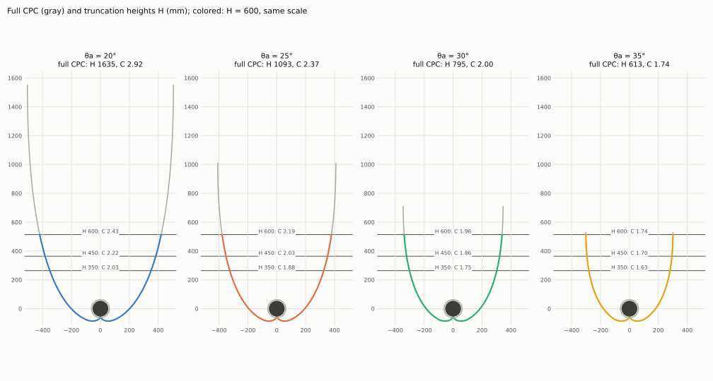
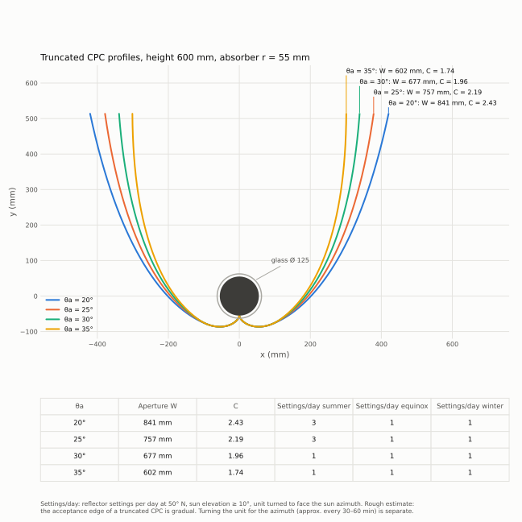
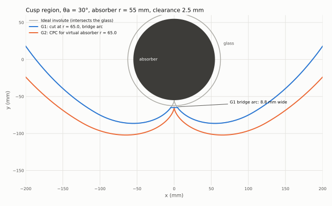
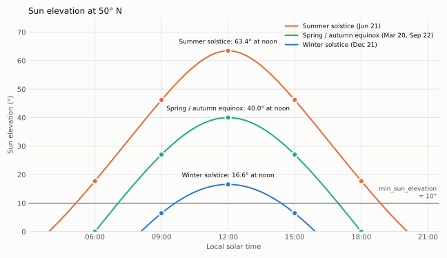

# Optics: Involute CPC for a Tubular Absorber

## Profile
A CPC (Compound Parabolic Concentrator) for a cylindrical absorber has two sections per branch:
- Involute section: behind the absorber. Reflects all rays inside the acceptance angle onto the absorber.
- Parabolic section: from the end of the involute to the aperture.

Notation:
- `r`: absorber radius (`absorber_r`).
- `θa`: half-acceptance angle.
- `θ`: angle of the tangent point on the absorber, measured from the bottom of the absorber.
- `ρ(θ)`: length of the tangent line from the tangent point to the reflector.

Equations (Rabl, 1976):
- Involute, `0 ≤ θ ≤ θa + π/2`: `ρ = r·θ`
- Parabola, `θa + π/2 ≤ θ ≤ 3π/2 − θa`: `ρ = r·(θ + θa + π/2 − cos(θ − θa)) / (1 + sin(θ − θa))`
- Point, absorber centre at the origin, optical axis +y: `x = r·sin θ − ρ·cos θ`, `y = −r·cos θ − ρ·sin θ`
- The second branch is the mirror image about the y axis.

Concentration ratio of the full CPC: `C = 1 / sin θa` (aperture width / absorber circumference).

## Truncation
The full CPC is too large for this tube. Truncation reduces height and material with a small loss of concentration.
Values for `r` = 55 mm (absorber Ø 110 mm). `W` = aperture width, `arc` = reflector arc length per branch.

| θa | C full | Full CPC W × H | H = 350: W / C / arc | H = 450: W / C / arc | H = 600: W / C / arc |
|----|--------|----------------|----------------------|----------------------|----------------------|
| 20° | 2.92 | 1010 × 1635 | 700 / 2.03 / 546 | 766 / 2.22 / 652 | 841 / 2.43 / 806 |
| 25° | 2.37 | 818 × 1093 | 650 / 1.88 / 532 | 702 / 2.03 / 635 | 757 / 2.19 / 788 |
| 30° | 2.00 | 691 × 795 | 604 / 1.75 / 520 | 643 / 1.86 / 622 | 677 / 1.96 / 773 |
| 35° | 1.74 | 602 × 613 | 562 / 1.63 / 510 | 588 / 1.70 / 611 | 602 / 1.74 / 761 |

Conclusions:
- At a fixed height, a smaller `θa` adds little concentration. A larger `θa` gives a wider acceptance range.
- Compared with the bare tube (projected width 2·r = 110 mm), the aperture collects 5–8× more radiation, before reflection losses.

Selected design: `θa` = 20°, `H` = 600 mm.
| Value | Result |
|-------|--------|
| Aperture width W | 841 mm |
| Concentration C | 2.43 |
| Arc length per branch | 806 mm |
| Arm length (straight line, cusp to aperture edge) | 707 mm |
| Aperture edge position (relative to the tube centre) | x = ±420, y = 514 |
| Lowest profile point | y = −86 |

## Gap Between Reflector and Absorber
The ideal involute touches the absorber at the cusp. The glass envelope (`tube_od` / 2 = 62.5 mm) prevents this.
The gap between the absorber and the reflector is at least 5–8 mm, plus clearance.
Rays through the gap miss the absorber (gap loss, typically a few percent).
Options, to decide in CAD:
- G1: Cut the profile at the radius `tube_od / 2 + clearance`. Simplest approach.
- G2: Design the involute for a virtual absorber with a larger radius. Lower concentration, no cut.
- G3: Modified cusp shape (literature: "gap loss" designs, Rabl / McIntire).

At θa = 30° and 2.5 mm clearance, G1 removes the cusp only within 4.4 mm of the centre line. A bridge arc of 8.8 mm width at r = 65 mm joins the branches.
G2 moves the profile approx. 15 mm (bottom) to 40 mm (sides) outwards and lowers the concentration onto the real absorber.

Regenerate the CPC plots: `python3 solar_tube_cooker/tools/plot_reflector_options.py` (requires matplotlib). Profile maths: `solar_tube_cooker/tools/cpc.py`.

## Tracking
The tube axis is horizontal. Two sun movements are relevant:

| Movement | Compensation | Tolerance |
|----------|--------------|-----------|
| Elevation (sun angle in the tube cross-section plane) | Rotate the arm pairs (C2) about the tube axis. | ±θa. Aim ahead of the sun to use the full window 2·θa. |
| Azimuth (sun direction along the horizon) | Rotate the whole unit on the ground. | No hard limit. Loss is approx. cosine of the azimuth error plus end losses (see below). |

Elevation:
- Rate of change: up to approx. 10°/h in the morning and afternoon. Near 0°/h at noon.
- A setting covers the day if 2·θa ≥ the daily elevation range. At 50° N with `min_sun_elevation` = 10°, the range is 53.4° in summer (10–63.4°), 30° at equinox and 6.6° in winter.

Reflector settings per day (rough estimate, `solar_tube_cooker/tools/adjustment.py`; unit turned to face the sun azimuth):

| θa | Summer | Equinox | Winter |
|----|--------|---------|--------|
| 20° | 3 | 1 | 1 |
| 25° | 3 | 1 | 1 |
| 30° | 1 | 1 | 1 |
| 35° | 1 | 1 | 1 |

Limits of the estimate:
- The acceptance edge of a truncated CPC is gradual. Near the window edges, less radiation reaches the absorber.
- If the unit does not face the sun azimuth, the sun angle in the cross-section plane is larger than the elevation (`tan p = tan e / cos Δ`, `Δ` = azimuth error).

Azimuth:
- Rate of change: approx. 15°/h on average. Up to approx. 30°/h near noon in summer at high latitudes.
- An azimuth error of 15° costs approx. 3.5 % (cosine loss). End losses add to this: rays at a longitudinal angle land beyond the tube end. An end mirror or a reflector longer than `useful_length` reduces end losses.
- Rotate the unit approx. every 30–60 min.

Alternative orientation (not planned, the same hardware supports it): tube axis north–south. The reflector then follows the daily sun movement (15°/h), and the sun elevation becomes a longitudinal angle with high cosine losses at low sun. This mode needs frequent reflector adjustment.

## Tilt Range
- The reflector tilt from vertical equals 90° minus the sun elevation in the cross-section plane.
- The design input is `min_sun_elevation`: the lowest sun elevation for cooking. Maximum tilt = 90° − `min_sun_elevation`.
- Minimum tilt: 90° minus the highest sun elevation at the site (63.4° at 50° N, summer solstice).
- At large tilt, the lower aperture rim moves towards the ground. The tube axis height limits the maximum tilt. Determine it in the CAD assembly.

Noon elevation at latitude `φ`: `90° − |φ − δ|`, with the declination `δ` between −23.44° (winter solstice) and +23.44° (summer solstice).

### Example: 50° N

Time is local solar time (12:00 = solar noon). In Central Europe, solar noon is at approx. 12:00–12:45 CET (13:00–13:45 CEST), depending on longitude and date.
The spring and autumn equinoxes have the same curve.

| Time | Summer solstice (Jun 21) | Equinox (Mar 20, Sep 22) | Winter solstice (Dec 21) |
|------|---|---|---|
| 06:00 | 17.7° | 0.0° | below horizon |
| 09:00 | 46.2° | 27.0° | 6.4° |
| 12:00 | 63.4° | 40.0° | 16.6° |
| 15:00 | 46.2° | 27.0° | 6.4° |
| 18:00 | 17.7° | 0.0° | below horizon |
| 21:00 | below horizon | below horizon | below horizon |

Cooking windows for `min_sun_elevation` = 10° (maximum tilt 80°):
- Summer: approx. 05:10–18:50. Tilt range 26.6–80°.
- Equinox: approx. 07:05–16:55. Highest elevation 40°.
- Winter: approx. 09:35–14:25. Highest elevation 16.6°. Tilt range 73.4–80°.

Regenerate the plot and table: `python3 solar_tube_cooker/tools/sun_elevation.py` (requires matplotlib).
